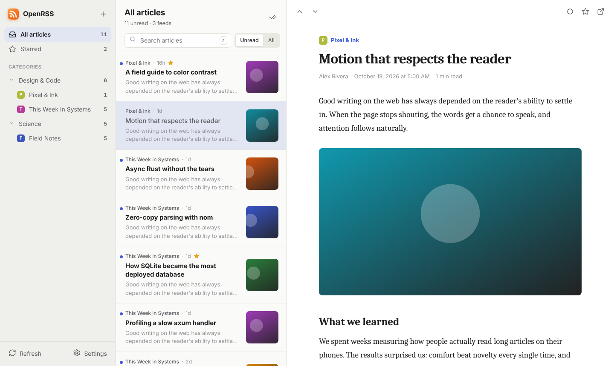
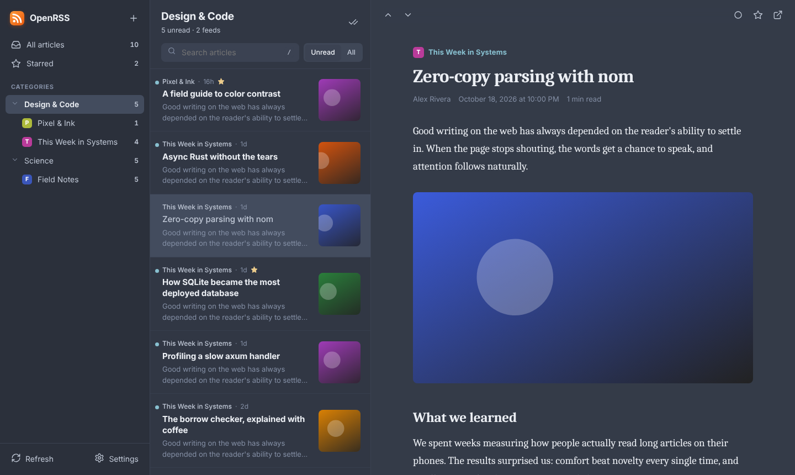
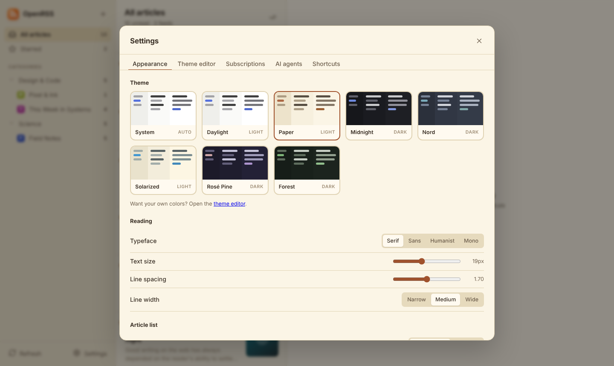
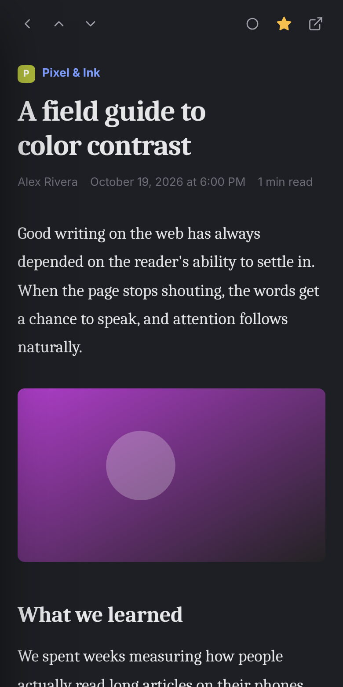

# OpenRSS

A calm, beautiful, self-hosted RSS reader, in a single 8 MB Docker image, with a built-in
[Model Context Protocol](https://modelcontextprotocol.io) server so AI agents can manage your feeds for you.



- **Made for reading.** A three-pane layout with a typography-first reader: adjustable typeface,
  size, line spacing and line width. It works on phones too.
- **Themes.** Eight built-in themes (Daylight, Paper, Midnight, Nord, Solarized, Rosé Pine,
  Forest, or follow the system). A live theme editor lets you build your own colors and add custom CSS,
  then share themes as JSON.
- **Agent-ready.** An MCP endpoint (`/mcp`) exposes 17 tools for subscribing, organizing, refreshing,
  searching, reading and triaging. Agents get articles as clean Markdown.
- **Every feed format.** RSS 0.9x/1.0/2.0, Atom and JSON Feed. Paste any website and its feed is
  discovered. Podcast enclosures get an audio player.
- **Small and fast.** One Rust binary with SQLite (FTS5 full-text search) and the UI embedded,
  using conditional requests (ETag/Last-Modified) to stay light on the sites you follow.
- **Your data.** OPML import/export, a JSON REST API, optional authentication.

| Nord theme | Theme picker | Mobile |
| --- | --- | --- |
|  |  |  |

## Quick start

```sh
docker run -d --name openrss -p 8080:8080 -v openrss-data:/data \
  -e AUTH_PASSWORD=change-me -e API_TOKEN="$(openssl rand -hex 32)" \
  ghcr.io/pmorcrette/openrss:latest
```

Open <http://localhost:8080> and sign in as `admin` with your password. Images are published by CI
for `linux/amd64` and `linux/arm64`. To build the image yourself instead:

```sh
git clone https://github.com/pmorcrette/openrss && cd openrss
docker compose up -d --build     # edit docker-compose.yml to set AUTH_PASSWORD and API_TOKEN
```

## Configuration

Everything is configured with environment variables:

| Variable | Default | Description |
| --- | --- | --- |
| `PORT` | `8080` | HTTP port. (`HOST`, default `0.0.0.0`, sets the interface.) |
| `DATA_DIR` | `./data` (`/data` in Docker) | Where the SQLite database lives. |
| `AUTH_PASSWORD` | unset | Enables HTTP basic auth for the web UI and REST API. |
| `AUTH_USER` | `admin` | Basic auth user name. |
| `API_TOKEN` | unset | Bearer token for `/mcp`. Also accepted by the REST API, for scripts. |
| `MCP_ENABLED` | `true` | Set to `false` to turn off the HTTP MCP endpoint. |
| `MCP_ALLOWED_HOSTS` | any | Comma-separated `Host` values accepted on `/mcp` (DNS-rebinding protection). |
| `REFRESH_INTERVAL` | `30` | Minutes between automatic refreshes of every feed. |
| `RETENTION_DAYS` | `60` | Delete read, unstarred articles older than this. Each feed always keeps its 50 newest. `0` keeps everything. |
| `FETCH_TIMEOUT` | `20` | Seconds before a feed request times out. |
| `FETCH_CONCURRENCY` | `6` | Feeds fetched in parallel. |
| `USER_AGENT` | `OpenRSS/<version>` | User agent sent to sites. |
| `LOG_LEVEL` | `info` | Log filter, e.g. `debug` or `openrss=debug,info`. |

> [!IMPORTANT]
> Without `AUTH_PASSWORD` and `API_TOKEN`, anyone who can reach the server can read and change your
> subscriptions. Set both before exposing OpenRSS beyond your machine, and put it behind HTTPS
> (Caddy, Traefik, nginx…) so credentials are not sent in clear text.

How authentication applies:

- **Web UI and `/api`**: open when `AUTH_PASSWORD` is unset; otherwise basic auth, or the
  `API_TOKEN` as a bearer token. `/api/health` is always open for health checks.
- **`/mcp`**: open only when neither `API_TOKEN` nor `AUTH_PASSWORD` is set; otherwise it accepts
  the bearer token or the basic auth credentials.

## Connecting AI agents (MCP)

OpenRSS serves MCP over Streamable HTTP at `/mcp` (stateless, so server restarts never break a
session), and over stdio with `openrss mcp`. The **Settings → AI agents** tab shows ready-to-copy
commands for your server's address.

**Claude Code**

```sh
claude mcp add --transport http openrss https://rss.example.com/mcp \
  --header "Authorization: Bearer $OPENRSS_API_TOKEN"
```

**Any MCP client (JSON config)**

```json
{
  "mcpServers": {
    "openrss": {
      "type": "http",
      "url": "https://rss.example.com/mcp",
      "headers": { "Authorization": "Bearer YOUR_API_TOKEN" }
    }
  }
}
```

**stdio**, for clients that launch a local process. It shares the database with the running server:

```json
{ "mcpServers": { "openrss": { "command": "docker", "args": ["exec", "-i", "openrss", "/openrss", "mcp"] } } }
```

### Tools

| Tool | What it does |
| --- | --- |
| `get_overview` | Totals, categories, and every feed with unread counts and errors. Start here. |
| `list_feeds` | Feeds with full details, optionally by category. |
| `add_feed` | Subscribe by feed or website URL (auto-discovery), with optional category and title. |
| `discover_feeds` | Find the feeds a website offers, without subscribing. |
| `update_feed` | Rename a feed, move it to a category, or change its URL. |
| `remove_feed` | Unsubscribe and delete the feed's articles. |
| `refresh_feeds` | Fetch new articles now, for some feeds or all. |
| `list_categories` / `create_category` / `rename_category` / `delete_category` | Organize feeds. |
| `list_articles` | List or full-text search articles by feed, category, read state or star. |
| `get_article` | Read one article as Markdown (or HTML), optionally marking it read. |
| `mark_articles` | Mark articles read/unread and starred/unstarred. |
| `mark_all_read` | Mark everything, a feed, or a category as read, optionally before a date. |
| `import_opml` / `export_opml` | Move subscriptions in and out. |

Things you can ask an agent:

- "Subscribe me to the Rust and Go blogs in a *Programming* category."
- "Summarize today's unread articles and star the ones about databases."
- "Find feeds that keep failing, and fix or remove them."

## Custom themes

Open **Settings → Theme editor**. Changes preview live across the whole app:

1. Pick colors for each part of the interface (backgrounds, text, accent, links, unread marker…).
2. Optionally add custom CSS. Every color is a CSS variable (`var(--accent)`, `var(--bg-reader)`…),
   and the reader uses `--font-reading`, `--reader-size`, `--reader-leading` and `--reader-width`.
3. Save. Themes are stored on the server, so they follow you to every device, and you can export or
   import them as JSON:

```json
{
  "name": "Ocean",
  "base": "dark",
  "vars": { "--bg-reader": "#0b1e2d", "--text": "#e3f2fd", "--accent": "#4dd0e1", "--link": "#80deea" },
  "custom_css": ".reader-title { letter-spacing: -0.03em; }"
}
```

Unset variables fall back to the Daylight or Midnight theme, depending on `base`.

## Keyboard shortcuts

| Keys | Action |
| --- | --- |
| `j` / `k` | Next / previous article |
| `m` | Toggle read |
| `s` | Toggle star |
| `v` | Open the original article |
| `/` | Search |
| `u` | Toggle unread only |
| `r` | Refresh all feeds |
| `a` | Add a feed |
| `Shift` + `A` | Mark all as read |
| `g` then `a` / `s` | Go to all articles / starred |
| `t` | Switch between light and dark |
| `?` | Show shortcuts |

## REST API

The web UI uses a small JSON API that you can script against (send the `API_TOKEN` as a bearer token):

| Method & path | Description |
| --- | --- |
| `GET /api/feeds`, `POST /api/feeds` `{url, category?, title?}` | List or subscribe |
| `PATCH /api/feeds/{id}` `{title?, category?, url?}`, `DELETE /api/feeds/{id}` | Edit or unsubscribe |
| `POST /api/feeds/{id}/refresh`, `POST /api/refresh` | Refresh one or all feeds |
| `GET /api/articles?feed_id=&category=&status=unread&starred=true&q=&limit=&offset=` | List and search |
| `GET /api/articles/{id}`, `PATCH /api/articles/{id}` `{read?, starred?}` | Read and flag |
| `POST /api/articles/mark-all-read` `{feed_id?, category?, before?}` | Bulk mark read |
| `GET /api/categories`, `POST`, `PATCH /api/categories/{id}`, `DELETE` | Categories |
| `GET /api/opml`, `POST /api/opml` (OPML body) | Export / import |
| `POST /api/discover` `{url}` | Find feeds on a website |
| `GET /api/stats`, `GET /api/health` | Status |

## Development

You need a recent stable Rust toolchain.

```sh
cargo run                    # http://localhost:8080 ; the UI in public/ is read from disk in debug builds
cargo test                   # unit and end-to-end tests
cargo fmt && cargo clippy --all-targets
```

The backend uses axum, rusqlite (bundled SQLite), feed-rs, ammonia (HTML sanitizing) and
[rmcp](https://github.com/modelcontextprotocol/rust-sdk). The frontend is dependency-free ES modules
in `public/` with no build step, embedded into the release binary.

```
src/
  main.rs     CLI entry: serve, mcp (stdio), healthcheck
  lib.rs      router assembly and the refresh scheduler
  config.rs   environment configuration
  db.rs       SQLite schema and queries
  feeds.rs    fetching, parsing, sanitizing and discovering feeds
  opml.rs     OPML import and export
  api.rs      REST API
  mcp.rs      MCP tools
  auth.rs     basic auth and bearer tokens
  web.rs      embedded static files
public/       web UI (HTML, CSS, JS)
```

## License

[GPL-3.0-or-later](LICENSE)
